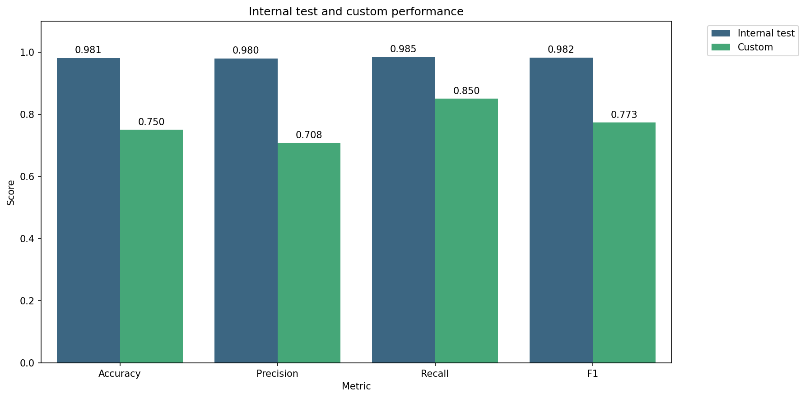
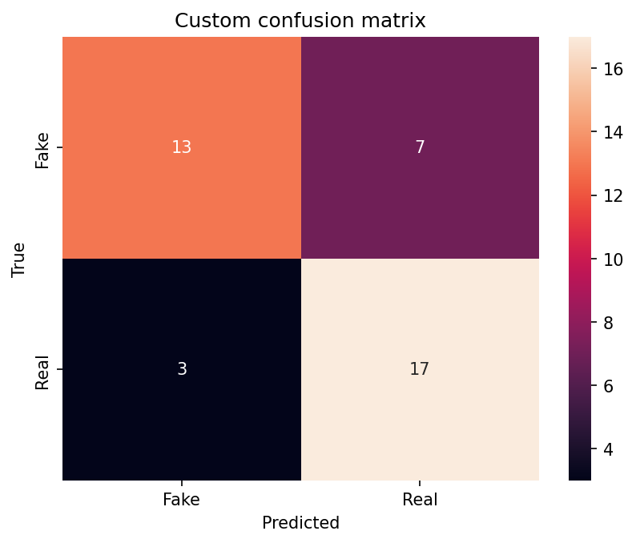

<div align="center">

# The headline gap

**Dataset bias and generalization in fake news classification**

[English](#english) · [Italiano](#italiano)

</div>

<a id="english"></a>

## Overview

Fake news classifiers can reach about 98% accuracy on a news dataset and still perform much worse on headlines from other sources. **The headline gap** measures that gap. It trains TF-IDF models (XGBoost, LinearSVC and MLP) on the Kaggle [Fake and Real News](https://www.kaggle.com/datasets/clmentbisaillon/fake-and-real-news-dataset) dataset, inspects the patterns they rely on, and evaluates them on a small custom set of 40 headlines. A second notebook extends the comparison with a fine-tuned DistilBERT.

Source and style patterns are associated with the dataset labels. These associations may help classification within the collection while limiting transfer to other news. The project studies that relationship; it does not verify claims against external evidence.

| | Notebook 1: main project | Notebook 2: extension |
|---|---|---|
| Focus | Exploratory analysis, classical models, headline-only baseline | DistilBERT fine-tuned on headlines |
| Input | Title and body; headline for the baseline | Headline |
| Models | XGBoost, LinearSVC, MLP; LinearSVC on headlines | `distilbert-base-uncased` |
| Research questions | RQ1 and RQ2; reference for RQ3 | Completes RQ3 |
| Hardware | CPU in the saved run | Colab T4 in the saved run; local CPU training and evaluation are also supported |

**Contents:** [Research questions](#research-questions) · [Method](#method) · [Results](#results) · [Repository structure](#repository-structure) · [Execution](#execution) · [Limitations](#limitations) · [Future work](#future-work)

## Research questions

The same three questions appear in both notebooks:

1. **RQ1:** Which dataset patterns could act as shortcuts instead of indicating factual truth?
2. **RQ2:** Do classical TF-IDF models retain their performance on external headlines?
3. **RQ3:** Does fine-tuned DistilBERT improve on the headline-only TF-IDF baseline, and which limitations remain?

Notebook 1 addresses RQ1 through data and feature inspection, and RQ2 through the gap between internal and custom accuracy. It also trains the headline-only LinearSVC that serves as the reference for RQ3. Notebook 2 completes RQ3 with the same partitions and the same custom headlines. Its final cell loads the classical metrics and checks that the partitions match before comparing models.

## Method

Both notebooks remove missing titles and bodies and keep the first occurrence of each exact headline before splitting. This leaves 38,729 articles: 17,903 Fake (46.2%) and 20,826 Real (53.8%). Near-duplicate headlines are not removed. The notebooks use the same row order, shuffle seed and stratified partitions: 23,236 training, 5,810 validation and 9,683 test examples (60%, 15% and 25%).

| Component | Classical models | DistilBERT |
|---|---|---|
| Input | Title and body; additional headline-only LinearSVC | Headline |
| Representation | TF-IDF, up to 1,000 unigram and bigram features | `distilbert-base-uncased`, maximum length 256 |
| Selection | Three-fold GridSearchCV on the training partition | Validation loss with early stopping, up to three epochs |
| Final evaluation | Held-out test and custom headlines | Held-out test and custom headlines |

TF-IDF is fitted inside each cross-validation fold. The vocabulary plots use a separate vectorizer fitted on the training partition. Both notebooks export partition IDs for inspection.

**Custom headlines.** The set contains 40 headlines, shared through `data/evaluation/custom_headlines.json`: 20 synthetic examples assigned label 0 (Fake) and 20 examples attributed to Reuters or AP News assigned label 1 (Real). Several synthetic headlines use agency-style wording, such as a Reuters mention or a weekday. This is an exploratory test. Source URLs, publication dates and independent label verification are still missing, and a generated headline is not necessarily factually false.

## Results

| Notebook | Model | Input | Internal test | Custom headlines |
|---|---|---|---:|---:|
| 1 | XGBoost | Title and body | 97.88% | 35.0% |
| 1 | LinearSVC | Title and body | 97.98% | 45.0% |
| 1 | MLP | Title and body | 97.75% | 35.0% |
| 1 | LinearSVC, headline baseline | Headline | 91.95% | 57.5% |
| 2 | DistilBERT | Headline | **98.11%** | **75.0%** |

### Notebook 1: classical models

The three full-text models are within 0.23 percentage points on the internal test. The differences are small and were not checked across repeated runs. Selected configurations: XGBoost with 100 trees, depth 5 and learning rate 0.2; LinearSVC with C=1 and an L1 penalty; MLP with one hidden layer of 16 units, `alpha=0.01` and initial learning rate `0.001`.

On the custom headlines the full-text models reach 35-45%. Since the set has 20 headlines per class, a constant prediction would score 50%. XGBoost labels none of the 20 Real headlines as Real, while LinearSVC and MLP recover 35% and 25% of them. The headline-only LinearSVC falls from 91.95% to 57.5%, with Fake recall of 25% and Real recall of 90%. Matching the input length therefore does not remove the transfer problem.

LinearSVC coefficients link the decision rule to the patterns seen in the exploratory analysis. Terms associated with Fake include `featured image`, `getty`, `https` and `pic twitter`. Terms associated with Real include `reuters` and weekday names.

### Notebook 2: DistilBERT extension

DistilBERT makes 183 errors among 9,683 internal test headlines and correctly classifies 30 of the 40 custom headlines. The headline-only LinearSVC classifies 23 correctly, so the gain is seven predictions, or **17.5 percentage points**.

| Custom metric | Headline-only LinearSVC | DistilBERT |
|---|---:|---:|
| Correct predictions | 23 of 40 | 30 of 40 |
| Fake recall | 25% | 65% |
| Real recall | 90% | 85% |
| Macro F1 | 0.5248 | 0.7475 |

<p align="center">
  
  
</p>

The gain comes mainly from recognizing more examples assigned Fake, with one fewer correct Real prediction. DistilBERT still predicts Real for seven synthetic headlines (six political, one about climate) and misses three of the five AP News examples, all three on climate or environmental science. Several errors have high softmax scores. Calibration has not been evaluated. The custom set is small and one prediction changes accuracy by 2.5 percentage points.

### Answers to the research questions

| Question | Answer supported by the current results |
|---|---|
| RQ1 | Publisher names, weekdays, image credits and links appear in the data inspection or in high-weight linear features. They are candidate source and style cues, not general evidence of truth. |
| RQ2 | The full-text classifiers fall from about 98% internally to 35-45% on the custom headlines. The headline-only reference falls from 91.95% to 57.5%. Transfer is limited even when training and test inputs are both headlines. |
| RQ3 | DistilBERT improves custom accuracy from 57.5% to 75%. Fake recall rises from 25% to 65% and Real recall changes from 90% to 85%. The result supports better transfer on these selected examples, with errors remaining on formal synthetic headlines and some AP News headlines. |

The notebooks do not attribute the gap to a single cause, and the experiments do not show that the cues above cause the predictions.

## Repository structure

```text
.
├── data/
│   ├── raw/                         # Fake.csv and True.csv, excluded from Git
│   └── evaluation/
│       └── custom_headlines.json    # Shared examples and provenance fields
├── notebooks/
│   ├── 01_eda_ml_models_comparison.ipynb
│   └── 02_distilbert_generalization.ipynb
├── results/
│   ├── figures/
│   │   ├── 01_classical_ml/
│   │   └── 02_distilbert/
│   └── metrics/
│       ├── 01_classical_ml/
│       └── 02_distilbert/
├── docs/
│   └── environment.md               # Local CPU and Colab GPU setup
├── .gitignore
├── LICENSE
├── README.md
├── requirements-ml.txt              # Notebook 1
└── requirements.txt                 # Both notebooks
```

Figures are saved as PNG files at 150 dpi. Metrics, partition IDs and DistilBERT predictions are saved under `results/metrics/`. The DistilBERT metric files were recovered from the saved notebook outputs, and [saved_run.json](results/metrics/02_distilbert/saved_run.json) records their provenance, including the rounding of displayed confidence scores. Its figures were regenerated from the saved evaluation counts. Dataset files, checkpoints and local environments are excluded from version control.

## Execution

The [environment guide](docs/environment.md) covers Windows with Conda, local CPU and Colab GPU setups, with an Italian explanation. Python 3.11 is recommended.

| Task | Setup |
|---|---|
| Run notebook 1 on CPU | Install `requirements-ml.txt` |
| Run notebook 2 locally on CPU | Install CPU PyTorch, then `requirements.txt` |
| Train DistilBERT on Colab | Select a GPU and install `requirements.txt`, keeping a compatible CUDA-enabled PyTorch |
| Evaluate on CPU after Colab training | Copy the full saved model folder locally and keep `FORCE_RETRAIN=False` |

The training stack is PyTorch `>=2.6,<3`, Transformers `>=4.57,<6`, Datasets `>=3,<5` and Accelerate `>=1.1,<2`. Notebook 1 does not depend on these packages. Run the environment check at the start of each notebook, and after installing or changing libraries restart the kernel or runtime and run from the top.

**Reported environment.** The DistilBERT results come from Google Colab with a Tesla T4 and Python 3.13.16. Python 3.11 is the recommended local setup; a separate CPU execution check used Python 3.11.13. The [environment guide](docs/environment.md) and [saved-run metadata](results/metrics/02_distilbert/saved_run.json) record the relevant versions.

**Data.** Both notebooks read `data/raw/Fake.csv` and `data/raw/True.csv`. If the files are missing, KaggleHub downloads the dataset, which requires internet access. If Kaggle asks for authentication, run `kagglehub.login()` and retry.

**Paths.** Launch from the repository root or from `notebooks/`, or set `PROJECT_ROOT` explicitly. On Colab, copy the whole repository to Drive, set `USE_COLAB=True` and adjust `PROJECT_ROOT`. Include `results/metrics/01_classical_ml/` to generate the final comparison.

**Devices.** `DEVICE_PREFERENCE='auto'` uses CUDA when available and CPU otherwise. CPU training uses batches of 4 with four accumulation steps and GPU training uses batches of 16, so the effective batch size is 16 in both cases. Both use the complete training partition. Fine-tuning on GPU and evaluating on CPU is the practical workflow for notebook 2.

**Checkpoints.** The selected model, tokenizer and evaluation metadata are saved under `distilbert_model/split_60_15_25_v1/`, and training checkpoints under `training_results/`. With `FORCE_RETRAIN=False`, a saved model is reused only when its recorded data and partitions match.

**Reproducibility.** Split and training seeds are set to 42. Package ranges are not a frozen environment, so hardware, versions and training randomness can still affect results. Exact-title deduplication changes the share of Fake articles from 52.3% in the raw files to 46.2%.

## Limitations

- The custom set is small and selected by hand. Its labels and source attributions need verification, and one prediction changes accuracy by 2.5 percentage points.
- Full-text and headline models receive different information. The headline-only baseline improves comparability, but preprocessing and model selection still differ between it and DistilBERT. The full-text cleaning rule can remove the title when a Reuters dateline follows it, and bracket removal may discard content.
- Source and style associations suggest possible shortcuts without establishing causality. Recognizing Reuters phrasing does not demonstrate factual reasoning.
- Architecture, pretraining and regularization are not separated by ablations, so the improvement cannot be assigned to one factor. Results come from a single run for each model.
- Exact-headline deduplication keeps the first occurrence. Fake articles are concatenated first, so a title present in both files would keep the Fake label. No exact-title conflicts between labels were found in the supplied files. Near-duplicates are not removed.

## Future work

- **More diverse data:** include more publishers, topics, periods and writing styles in both classes. False examples should include formal reporting, and true examples should extend beyond agency-style news.
- **A larger external evaluation:** document source links and dates, verify labels and reduce overlap in source and topic patterns between training and evaluation.
- **Larger pretrained models:** compare encoders with more parameters using the same partitions and inputs, and report computation time next to accuracy. Additional capacity may still learn dataset-specific cues.

## Author and license

Developed by **Emanuela Cannas** as a machine learning project for the BSc in Applied Computer Science and Data Analytics, with a second notebook that extends the analysis with a pretrained NLP model.

Code is released under the [MIT License](LICENSE). External data and pretrained models remain subject to their own terms.

---

<a id="italiano"></a>

## Sintesi in italiano

**The headline gap** misura quanto l'accuracy su un dataset di notizie dica delle prestazioni su titoli di altre fonti. Il [primo notebook](notebooks/01_eda_ml_models_comparison.ipynb) è il lavoro principale di machine learning: analisi esplorativa, preprocessing, TF-IDF e confronto tra XGBoost, LinearSVC e MLP, con una baseline LinearSVC addestrata sui soli titoli. Il [secondo notebook](notebooks/02_distilbert_generalization.ipynb) è un approfondimento: fine-tuning di DistilBERT sui titoli e confronto con la baseline.

Le classi presentano differenze di fonte e stile che possono facilitare la classificazione all'interno della raccolta. Il progetto studia quanto questi risultati si trasferiscano ad altri titoli; non verifica le affermazioni attraverso prove esterne.

### Domande di ricerca

1. Quali caratteristiche del dataset possono diventare scorciatoie senza indicare la verità dei contenuti?
2. I modelli classici TF-IDF mantengono le prestazioni sui titoli esterni?
3. DistilBERT migliora rispetto alla baseline TF-IDF sui soli titoli e quali limiti rimangono?

Il primo notebook risponde alle prime due e prepara il riferimento per la terza. Il secondo completa la terza domanda.

### Protocollo

Entrambi i notebook leggono gli stessi CSV, rimuovono i valori mancanti e conservano la prima occorrenza di ogni titolo duplicato. Restano 38.729 articoli. Le partizioni stratificate sono condivise: 60% training, 15% validation e 25% test. Nei modelli classici gli iperparametri si scelgono con cross-validation a tre fold sul training e TF-IDF viene stimato dentro ogni fold. DistilBERT sceglie il checkpoint sulla validation e il test finale resta separato.

Il test personalizzato contiene 40 titoli: 20 sintetici etichettati Fake e 20 attribuiti a Reuters o AP News etichettati Real. È un test esplorativo: fonti ed etichette richiedono ulteriore verifica e l'origine sintetica di un titolo non ne garantisce la falsità.

### Risultati

Nel primo notebook i modelli su titolo e corpo ottengono il 97,75-97,98% sul test interno e il 35-45% sui titoli personalizzati. La baseline LinearSVC sui soli titoli passa dal 91,95% al 57,5%, con recall del 25% per Fake e del 90% per Real.

Nel secondo notebook DistilBERT raggiunge il 98,11% sul test interno e il 75% sui titoli personalizzati: 30 predizioni corrette su 40, contro le 23 della baseline. Il miglioramento è di 17,5 punti percentuali. La recall Fake passa dal 25% al 65%, quella Real dal 90% all'85%, e il macro F1 da 0,5248 a 0,7475. Restano errori su titoli sintetici in stile giornalistico formale e su tre titoli AP News di argomento climatico o ambientale.

Le associazioni con fonte e stile suggeriscono possibili scorciatoie, ma gli esperimenti non ne dimostrano l'effetto causale.

### Esecuzione e file prodotti

La [guida agli ambienti](docs/environment.md) descrive librerie, kernel, CPU locale, GPU Colab e trasferimento del modello. Per il primo notebook basta `requirements-ml.txt`. Il secondo usa `requirements.txt` e supporta training e valutazione su CPU; per il training completo è pratico usare Colab con GPU, poi copiare l'intera cartella del modello in locale e lasciare `FORCE_RETRAIN=False`. Dopo l'installazione delle librerie, riavviare il kernel o il runtime e ripartire dall'inizio.

I grafici sono in `results/figures/`, metriche, partizioni e predizioni in `results/metrics/`, i titoli personalizzati in `data/evaluation/custom_headlines.json`. I CSV mancanti vengono scaricati tramite KaggleHub in `data/raw/`. I risultati di DistilBERT provengono da Colab con Tesla T4 e Python 3.13.16; Python 3.11 è la versione consigliata per l’ambiente locale.

### Limiti e sviluppi

Il test personalizzato è piccolo e le etichette richiedono verifica. Il confronto sui soli titoli rende gli input più simili, ma preprocessing e selezione dei modelli restano diversi, e i risultati derivano da una sola esecuzione per modello.

Gli sviluppi futuri riguardano un dataset più diversificato per entrambe le classi, una valutazione esterna più ampia con fonti ed etichette verificate e il confronto con modelli preaddestrati con più parametri, mantenendo gli stessi input e criteri di valutazione e riportando il costo computazionale.

Progetto di **Emanuela Cannas**, per il percorso di laurea in Informatica Applicata e Data Analytics. Codice distribuito con [licenza MIT](LICENSE).
